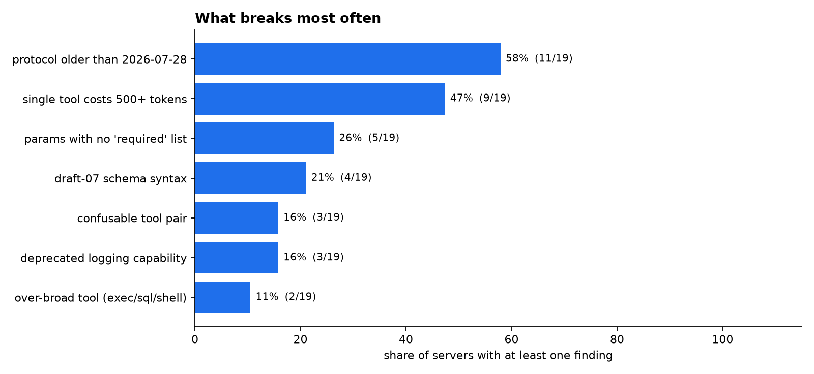

<div align="center">

# mcpvitals

**Vital signs for your MCP servers. One command gives you a health score, plus the checks nobody else runs.**

[](https://github.com/ContextJet-ai/mcpvitals/actions/workflows/tests.yml)
[](https://pypi.org/project/mcpvitals/)
[](LICENSE)
[](https://www.contextjetai.com)

</div>

> [!NOTE]
> We ran mcpvitals on 19 popular MCP servers that need no account to run, in November 2026 ([full results](docs/scan-2026-11/)). **11 of 19 still only speak the pre-2026-07-28 handshake**, 9 ship at least one tool that costs 500+ tokens to expose, and the heaviest costs ~12.7k tokens of context before you type anything. Registries show none of this, so a heavy or confusing server looks identical to a good one. `mcpvitals` is the checkup.

## 60-second start

No install. Point it at any MCP server (a stdio command or an http url):

```bash
uvx mcpvitals check "npx -y @your/mcp-server"
```

```text
mcp health: 40 (F)

  x MV020 [run_sql] tool 'run_sql' appears to contain a hard-coded secret
      -> never ship keys in tool metadata; use env vars
  x MV022 [run_sql] description contains model-directed instructions (poisoning surface)
      -> tool descriptions should describe, not instruct the model
  ! MV030 [run_sql] tool 'run_sql' costs ~410 tokens to expose
      -> trim the description/schema; it inflates every request
  ! MV040 tools 'get_user' and 'fetch_user' are 0.91 similar; agents may pick the wrong one
      -> differentiate names/descriptions or merge them
  i MV050 protocol 2025-03-26 predates the 2026-07-28 stateless spec
```

## What it checks

Most linters stop at basic conformance. `mcpvitals` runs those, and goes further on token cost, tool confusion and spec migration:

| Area | What it catches |
|---|---|
| **Conformance** | empty tool descriptions, duplicate tool names, malformed schemas |
| **Reliability** | parameters with no `required` list, untyped params, error-path gaps |
| **Security hygiene** | secrets in tool metadata, over-broad tools (`run_sql`, `exec`), model-directed instructions in descriptions (the tool-poisoning surface) |
| **Token cost** | how many tokens each tool burns in the context window, and the total cost to connect the server |
| **Tool confusion** | pairs of tools an agent will mix up, predicted from name/description overlap *before* it happens in production |
| **Migration readiness** | what breaks under the 2026-07-28 stateless spec: old protocol, deprecated caps, core `tasks` (now an extension), unstable `tools/list` order, missing `ttlMs`/`cacheScope`/`resultType`, no `server/discover` support, draft-07 schema constructs |

Every check is a pure function scored deterministically. Run `mcpvitals check --json` for machine output.

The first run of an `npx`/`uvx` server includes its download, which can take a minute or two (Puppeteer pulls a whole Chromium). The default `--timeout` is 180 s. mcpvitals tries the 2026-07-28 `server/discover` handshake first and falls back to `initialize`; for a server that stalls on the probe, `--handshake initialize` skips it.

## State of MCP servers (Nov 2026)



19 popular servers that run without an account, each in a throwaway Docker container. Servers that need a key were left out of the ranking, since their tool list can differ once you sign in. Per-server scores, token costs and raw JSON are in [docs/scan-2026-11](docs/scan-2026-11/), along with the scripts to rerun it.

## Add the health badge to your README

`mcpvitals` emits a shareable badge so a good score is visible at a glance:

```bash
mcpvitals check "npx your-server" --badge badge.svg
```

## Use it in CI

Gate your server on every push with the bundled GitHub Action:

```yaml
- uses: ContextJet-ai/mcpvitals@v0
  with:
    target: "python -m your_server"
    strict: "true"      # fail the build on any error-level finding
    fail-under: "80"    # or fail when the score drops below a number
    sarif: mcpvitals.sarif
- uses: github/codeql-action/upload-sarif@v3
  with:
    sarif_file: mcpvitals.sarif   # findings show up in the Security tab and on PRs
```

Locally: `mcpvitals check "npx your-server" --fail-under 80 --sarif out.sarif`.

## Track and monitor (not just a one-shot check)

Pin a server's tools and get alerted when they change. This catches **rug-pulls**, where a server you already approved silently mutates a tool's schema or description after the fact:

```bash
mcpvitals watch "npx your-server"           # first run pins tools to mcp.lock; later runs fail if anything changed
mcpvitals watch "npx your-server" --check    # in CI: same, and also fails if there is no lock yet
mcpvitals watch "npx your-server" --update   # you reviewed the change: accept it and re-pin
```

Probe a running server for live health (uptime and latency):

```bash
mcpvitals monitor "https://your-server/mcp" --count 5
# probe 1/5: up 210ms ... uptime 100.0%  avg 207ms
```

## Why this exists

The MCP ecosystem grew faster than the tooling around it. There are thousands of servers and no standard way to tell whether one is any good, safe, or cheap to run. `mcpvitals` gives authors a one-command checkup before they publish, and gives everyone else a way to vet a server before they trust it.

Built by [ContextJet.ai](https://www.contextjetai.com). MIT licensed. Contributions welcome, see [CONTRIBUTING.md](CONTRIBUTING.md).
