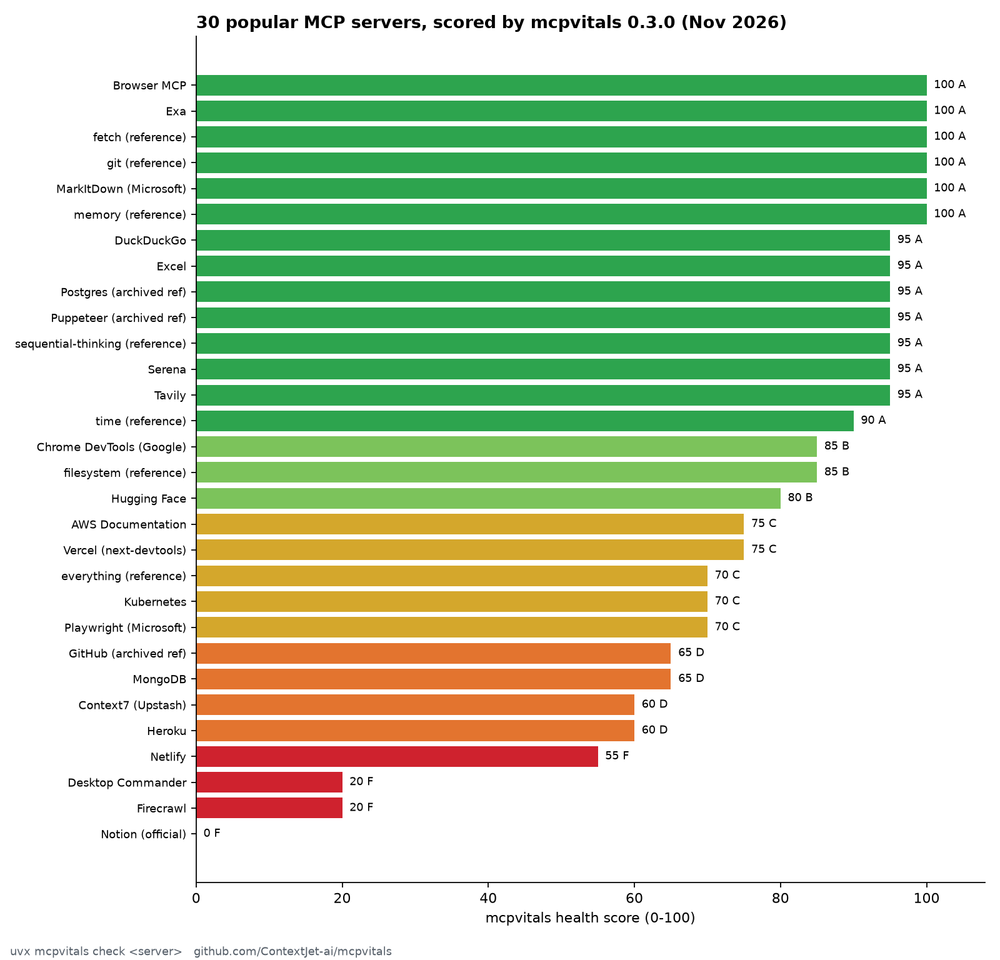
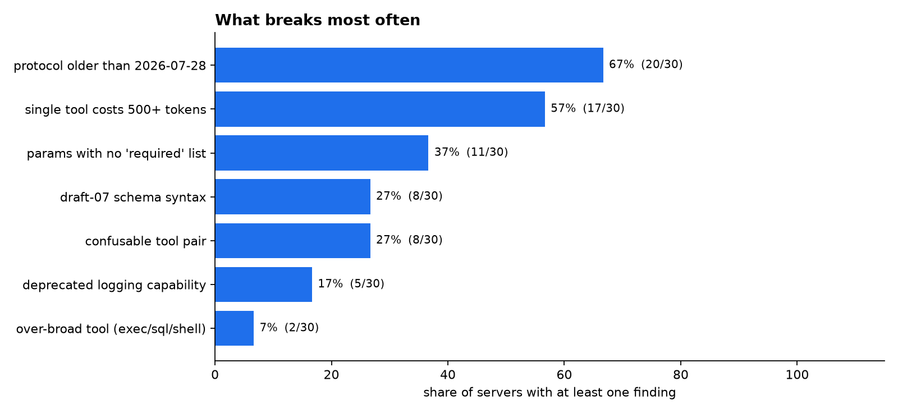

# MCP server scan, November 2026

42 popular MCP servers checked with `mcpvitals 0.3.0` on 2026-11-10; 30 started and answered `tools/list`.
Each ran in a throwaway Docker container with placeholder credentials, so no real accounts were touched. Rerun any row with `uvx mcpvitals check "<command>"`.
Scores are heuristics: a low score is a list of things worth a look (context cost, confusable tools, spec drift), not a claim that a server is broken or unsafe.

| Server | Score | Tools | Tokens to connect | Protocol | Top findings |
|---|---|---|---|---|---|
| Browser MCP | 100 (A) | 1 | 247 | 2025-11-25 | MV050, MV056, MV031 |
| Exa | 100 (A) | 2 | 450 | 2025-11-25 | MV055x2, MV050, MV056, MV031 |
| fetch (reference) | 100 (A) | 1 | 341 | 2026-07-28 | MV031 |
| git (reference) | 100 (A) | 14 | 1459 | 2026-07-28 | MV031 |
| MarkItDown (Microsoft) | 100 (A) | 1 | 60 | 2026-07-28 | MV031 |
| memory (reference) | 100 (A) | 9 | 1066 | 2025-11-25 | MV055x9, MV050, MV056, MV031 |
| DuckDuckGo | 95 (A) | 3 | 1020 | 2026-07-28 | MV030, MV031 |
| Excel | 95 (A) | 6 | 1269 | 2025-03-26 | MV050, MV056, MV030, MV031 |
| Postgres (archived ref) | 95 (A) | 1 | 24 | 2024-11-05 | MV050, MV056, MV010, MV031 |
| Puppeteer (archived ref) | 95 (A) | 7 | 567 | 2024-11-05 | MV050, MV056, MV031, MV040 |
| sequential-thinking (reference) | 95 (A) | 1 | 1003 | 2025-11-25 | MV050, MV056, MV055, MV030 |
| Serena | 95 (A) | 3 | 887 | 2026-07-28 | MV030, MV031 |
| Tavily | 95 (A) | 5 | 1963 | 2025-11-25 | MV050, MV056, MV030, MV031 |
| time (reference) | 90 (A) | 3 | 508 | 2026-07-28 | MV010x2, MV031 |
| Chrome DevTools (Google) | 85 (B) | 32 | 6881 | 2025-11-25 | MV030x2, MV050, MV051, MV056 |
| filesystem (reference) | 85 (B) | 14 | 1927 | 2025-11-25 | MV021x2, MV050, MV056, MV031 |
| Hugging Face | 80 (B) | 5 | 2627 | 2025-11-25 | MV010x2, MV030x2, MV050, MV056 |
| AWS Documentation | 75 (C) | 5 | 4005 | 2026-07-28 | MV030x5, MV031 |
| Vercel (next-devtools) | 75 (C) | 4 | 1362 | 2025-11-25 | MV010x4, MV050, MV056, MV030 |
| everything (reference) | 70 (C) | 13 | 1147 | 2025-11-25 | MV055x13, MV010x4, MV050, MV051 |
| Kubernetes | 70 (C) | 23 | 5797 | 2025-11-25 | MV010x4, MV050, MV056, MV030 |
| Playwright (Microsoft) | 70 (C) | 25 | 4534 | 2025-11-25 | MV010x6, MV050, MV056, MV031 |
| GitHub (archived ref) | 65 (D) | 26 | 3939 | 2024-11-05 | MV055x26, MV040x7, MV050, MV056 |
| MongoDB | 65 (D) | 27 | 16133 | 2026-07-28 | MV030x4, MV040x2, MV051, MV031 |
| Context7 (Upstash) | 60 (D) | 2 | 1218 | 2026-07-28 | MV022x2, MV030x2, MV031 |
| Heroku | 60 (D) | 33 | 4880 | 2025-11-25 | MV055x33, MV010x7, MV050, MV056 |
| Netlify | 55 (F) | 10 | 5358 | 2026-07-28 | MV040x7, MV030x2, MV031 |
| Desktop Commander | 20 (F) | 25 | 12700 | 2025-11-25 | MV055x25, MV030x9, MV010x2, MV021x2 |
| Firecrawl | 20 (F) | 26 | 13775 | 2025-11-25 | MV055x26, MV030x9, MV010x6, MV050 |
| Notion (official) | 0 (F) | 24 | 19775 | 2025-11-25 | MV040x52, MV030x24, MV010x2, MV050 |

## Most common findings

- **protocol older than 2026-07-28** (MV050): 20 of 30 servers
- **only the legacy initialize handshake** (MV056): 20 of 30 servers
- **single tool costs 500+ tokens** (MV030): 17 of 30 servers
- **params with no 'required' list** (MV010): 11 of 30 servers
- **draft-07 schema syntax** (MV055): 8 of 30 servers
- **confusable tool pair** (MV040): 8 of 30 servers
- **deprecated logging capability** (MV051): 5 of 30 servers
- **over-broad tool (exec/sql/shell)** (MV021): 2 of 30 servers
- **core 'tasks' capability** (MV052): 1 of 30 servers
- **model-directed text in description** (MV022): 1 of 30 servers
- **untyped params** (MV011): 1 of 30 servers

## Did not start in the sandbox

Usually because the server needs a real account or a browser at startup. Not a judgement on the server.

- AWS Knowledge base: exited before tools/list
- Brave Search: exited before tools/list
- Cloudflare: exited before tools/list
- Docker Hub: exited before tools/list
- ElevenLabs: exited before tools/list
- Figma (Framelink): exited before tools/list
- Sentry: exited before tools/list
- Slack (archived ref): exited before tools/list
- SQLite: exited before tools/list
- Stripe: exited before tools/list
- Supabase: exited before tools/list
- Atlassian (community): started but listed no tools (needs real credentials)

Median context cost to connect: ~1459 tokens; heaviest: ~19775 tokens.
